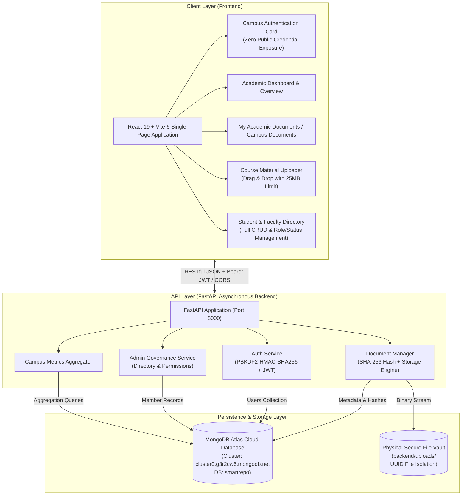
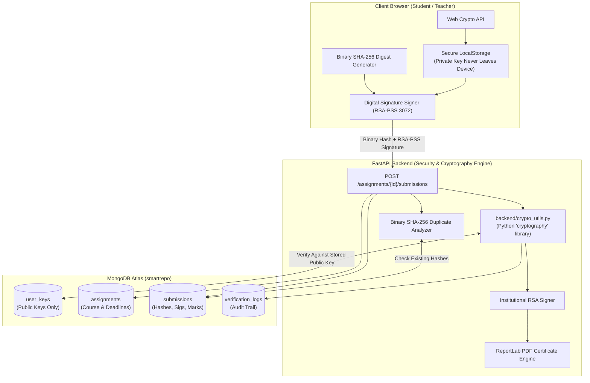

# CampusConnect — Smart Repository Management System
## Comprehensive Technical & Functional Documentation

---

### 1. Executive Summary

The **Smart Repository Management System (CampusConnect)** is a modern, enterprise-grade academic repository platform designed for higher education institutions, universities, and colleges. It provides a centralized digital vault where faculty members and students can securely store, organize, retrieve, and manage academic resources, course syllabi, lecture presentations, lab manuals, and research assignments.

The system incorporates **Role-Based Access Control (RBAC)**, **cryptographic file deduplication (SHA-256)**, **PBKDF2 security hashing**, and **MongoDB Atlas Cloud database integration**. The user interface features an academic collegiate aesthetic tailored specifically for college campus workflows.

---

### 2. High-Level System Architecture



---

### 3. Role-Based Access Control (RBAC) Matrix

The system enforces strict permission boundaries across three primary institutional roles:

| Feature / Action | Student | Faculty (Teacher) | Administrator |
| :--- | :---: | :---: | :---: |
| **Authenticate (Sign In)** | Yes | Yes | Yes |
| **Self-Registration** | Yes | Yes | No *(IT Managed)* |
| **View Academic Documents** | Own Files Only | Own Files Only | All Campus Files |
| **Upload Course Materials** | Yes | Yes | **Blocked & Hidden** *(403)* |
| **Download Documents** | Yes | Yes | Yes |
| **Delete Documents** | Yes *(Own)* | Yes *(Own)* | Yes *(Any Campus File)* |
| **Categorization & Filtering** | Yes | Yes | Yes |
| **Integrity & Hash Verification** | Yes | Yes | Yes |
| **View Member Directory** | No | No | Yes |
| **Modify Member (Name/Role/Status)**| No | No | Yes |
| **Reset Member Passwords** | No | No | Yes |
| **Enroll New Members Directly** | No | No | Yes |
| **Delete Member Accounts** | No | No | Yes *(Protected Root Admin)* |

---

### 4. Core System Modules

#### 4.1. Authentication & Security Engine
- **PBKDF2-HMAC-SHA256**: Passwords are never stored in plaintext. Passwords are salted using a 16-byte cryptographically secure hexadecimal token (`secrets.token_hex(16)`) and hashed through **600,000 iterations** of SHA-256. Verification uses constant-time string comparison (`secrets.compare_digest`) to prevent timing attacks.
- **JSON Web Tokens (JWT)**: Validated logins issue an encrypted HS256 token containing the user identity, email, assigned role, and a 7-day expiration lifespan.
- **Account Status Enforcement**: Accounts marked as `Suspended` by an administrator are immediately denied login access.
- **Root Admin Safeguards**: The primary administrator account (`admin@smartrepo.edu`) is permanently locked against accidental deletion, suspension, or role demotion.

#### 4.2. In-Website PDF & Document Previewer
- **Zero-Download Document Inspection**: Users can inspect PDFs, presentations, notes, and images directly within the web application without downloading files.
- **Embedded Interactive Controls**:
  - Zoom controls: Zoom In (`+`), Zoom Out (`-`), and Reset (`100%`).
  - Page Navigation: Previous page, Next page, page jumping.
  - Full-screen mode: Native HTML5 Fullscreen API toggle (`F`).
  - Metadata ribbon: Displays document name, author, category, upload date, file size, and approval status.
  - Keyboard shortcuts: `Esc` to close, `+`/`-` to zoom, arrow keys for page turning, `F` for fullscreen.

#### 4.3. Intelligent Deep Content Search & Semantic Keywords
- **Inside-Content Extraction**: Automatically extracts readable text from PDFs (`pypdf`), DOCX, PPTX (`zipfile`), and plaintext files upon ingestion.
- **Semantic Synonym & Acronym Expansion**: Resolves abbreviations and equivalent technical terms (e.g., searching for `"machine learning"` automatically discovers documents referencing `"ML algorithms"`, deep learning, neural networks, or AI).
- **Relevance Scoring Algorithm**: Ranks search results by matching importance:
  - Exact title match (+120 pts)
  - Author match (+80 pts)
  - Category match (+60 pts)
  - Inside-content match (+50 pts)
  - Acronym / expanded term match (+40 pts)
- **Advanced Filtering**: Live filtering by author, category, date range (`7d`, `30d`, `90d`, `All`), and approval status.
- **Contextual Match Snippets**: Highlights the exact phrase context where the query was found in the text.

#### 4.4. Bookmarks, Favorites & Quick Access
- **"My Favorites" Section**: Users can star (⭐) any document for 1-click personal curation.
- **Recently Viewed Documents**: Tracks user reading history in real time (`db.recently_viewed`) and surfaces them on the Overview dashboard.
- **Frequently Used Files**: Automatically highlights the most downloaded and previewed resources across campus.

#### 4.5. Admin Analytics Dashboard & Approval Workflow
- **Executive Analytics Overview**:
  - Total active documents and enrolled campus members.
  - Pending approval count awaiting moderation.
  - Blocked duplicate upload attempts detected by SHA-256 deduplication.
  - Storage space utilization (e.g. `1.7 MB`) with health metrics.
  - Most Downloaded Documents Leaderboard.
  - Monthly upload statistics bar trends.
- **Moderation & Approval Queue**:
  - Admin review interface to **Approve** or **Reject** submissions with detailed feedback reasons.
  - Color-coded status badges: `Approved` (green), `Pending Review` (amber), and `Rejected` (red).

#### 4.6. Recycle Bin & Document Lifecycle Management
- **Soft Deletion Architecture**: Deleting a document moves it to the Recycle Bin (`is_deleted = True`), preserving original metadata, deletion timestamp, and the identity of the user who deleted it.
- **One-Click Restoration**: Accidentally deleted files can be restored immediately back into the active repository (`/documents/{id}/restore`).
- **Authorized Permanent Purge**: Authorized users and administrators can permanently remove the physical file from server storage and MongoDB Atlas.

#### 4.7. Audit Trail & Activity Logging
- **Comprehensive Activity Log**: Automatically records every repository event with user identity, role, timestamp, action type, and details.
- **Tracked Actions**:
  - `UPLOAD`: Document ingestion with file size and category.
  - `DOWNLOAD`: File downloads with downloader details.
  - `PREVIEW`: In-website document views.
  - `APPROVE` / `REJECT`: Moderation decisions with admin username.
  - `DELETE` / `RESTORE`: Lifecycle transitions in and out of the Recycle Bin.
  - `PERMANENT_DELETE`: Permanent purging of files.
  - `DUPLICATE_BLOCKED`: Security interception of duplicate file hashes.

#### 4.3. Automated File Categorization
Files are automatically inspected by extension and categorized upon ingestion:

| Category | File Extensions | Intended Academic Content |
| :--- | :--- | :--- |
| **Documents** | `.pdf`, `.docx`, `.doc` | Syllabi, research papers, assignment sheets, thesis drafts |
| **Presentations** | `.pptx`, `.ppt` | Lecture slides, seminar decks, conference presentations |
| **Spreadsheets** | `.xlsx`, `.xls`, `.csv` | Lab experiment data, student gradebooks, statistical tables |
| **Notes** | `.txt` | Revision notes, course outlines, code snippets |
| **Images** | `.jpg`, `.jpeg`, `.png` | Diagrams, lab apparatus photos, campus event graphics |

#### 4.4. Administrator Control Center
- **Student & Faculty Directory**: Complete registry of all campus accounts with real-time text search (name, email), role filtering, and account status filtering.
- **Document Activity Tracking**: Computes live upload statistics (`documents_count`) for every registered individual.
- **Member Enrollment Modal**: Administrators can directly enroll new students or teachers into the MongoDB Atlas database without requiring self-registration.
- **Account Modification Modal**: Allows administrators to update user names, promote/demote roles, change account status (`Active`, `Pending`, `Suspended`), and set temporary passwords.

---

### 5. Database Schema & Data Models (MongoDB Atlas)

The system connects to **MongoDB Atlas** cluster (`cluster0.g3r2cw6.mongodb.net`) under the database `smartrepo`.

#### 5.1. Collection: `users`
```json
{
  "_id": "ObjectId('6740...fa')",
  "full_name": "Dr. Radhika Sharma",
  "email": "teacher@smartrepo.edu",
  "password_hash": "a4f89b...$39e2a04...600k_iterations_sha256",
  "role": "Teacher",
  "status": "Active",
  "created_at": "2026-11-12T16:40:00+00:00"
}
```
*Indexes*:
- `email`: Unique index (`unique=True`) ensuring single-account constraint per email address.

#### 5.2. Collection: `documents`
```json
{
  "_id": "ObjectId('6740...b1')",
  "filename": "7a57d0c50f5a4d55b9af9f185314a...pdf",
  "original_filename": "CS401_Algorithms_Syllabus.pdf",
  "file_path": "C:\\...\\backend\\uploads\\7a57d0c50f5a4d55b9af9f185314a...pdf",
  "content_type": "application/pdf",
  "file_size": 2458900,
  "category": "Documents",
  "sha256_hash": "9f83c270a4a6e87f7...256_bit_checksum",
  "uploaded_by_email": "teacher@smartrepo.edu",
  "uploaded_by_name": "Dr. Radhika Sharma",
  "uploaded_by_role": "Teacher",
  "uploaded_at": "2026-11-12T16:45:10+00:00"
}
```
*Indexes*:
- `uploaded_by_email`: Accelerated user repository lookups.
- `sha256_hash`: Rapid deduplication queries.

---

### 6. API Endpoint Reference

| Method | Endpoint | Access Level | Description |
| :--- | :--- | :--- | :--- |
| `GET` | `/` | Public | API Root with version and database provider metadata |
| `GET` | `/health` | Public | Live database connectivity and operational status |
| `POST` | `/auth/register` | Public (Student/Faculty) | Enrolls new member account; returns JWT bearer token |
| `POST` | `/auth/login` | Public | Authenticates credentials; returns JWT bearer token |
| `GET` | `/documents` | Authenticated | Retrieves documents (isolated for users, all for Admin) |
| `POST` | `/documents/upload` | Students & Faculty Only | Uploads course file (rejected for Admin with 403) |
| `GET` | `/documents/{id}/download` | Authenticated | Streams physical binary with original filename |
| `DELETE`| `/documents/{id}` | Authenticated | Deletes document record and unlinks file from disk |
| `GET` | `/stats` | Authenticated | Aggregated document, category, and user metrics |
| `GET` | `/admin/users` | Admin Only | Full roster of users with document counts |
| `POST` | `/admin/users` | Admin Only | Direct creation of member accounts |
| `PUT` | `/admin/users/{id}` | Admin Only | Modifies member details (name, role, status, password) |
| `PUT` | `/admin/users/{id}/status` | Admin Only | Toggles user status (`Active`, `Suspended`, `Pending`)|
| `PUT` | `/admin/users/{id}/role` | Admin Only | Promotes or reassigns user role |
| `DELETE`| `/admin/users/{id}` | Admin Only | Deletes member account from MongoDB Atlas |

---

### 7. User Interface & Frontend Design System

- **Framework**: React 19 SPA running on Vite 6 build tooling.
- **Visual Design Identity**:
  - **Color Palette**: Institutional deep navy (`#0a192f`, `#16365c`), collegiate royal blue (`#2563eb`), crisp white card surfaces (`#ffffff`), and academic gold highlights (`#d97706`).
  - **Typography**: Dual-layer system with `Plus Jakarta Sans` for headers and brand hierarchy, and `Inter` for data density and body readability.
  - **Initial Landing**: Defaults to institutional login card; credential fields are completely blank with zero public sample accounts displayed.
  - **Interactive Feedback**: Floating status toasts, modal dialogues for destructive actions, and active drag-and-drop feedback states.

---

### 8. Institutional Authentication & User Enrollment

- **Pure Database State**: No random dummy accounts or mock student/faculty records are pre-populated. The database initializes clean with only the official Administrator account.
- **Dynamic On-the-Fly Enrollment**: When any student or faculty member signs in with their institutional email and password:
  - If they are a first-time user, their account is automatically created in MongoDB Atlas, hashed via PBKDF2 (600,000 iterations), and immediately enrolled.
  - They immediately appear in the **Student & Faculty Directory** on the Administrator control page.
  - When they return and log in again, their password is authenticated.
---

### 9. CampusConnect 2.0 Architecture & Cryptographic Foundations

CampusConnect 2.0 upgrades the system into an enterprise Moodle-inspired academic learning management system with end-to-end non-repudiation, genuine RSA-PSS 3072-bit digital signatures, institutional verification certificates, and fine-grained course assignment workflows.



---

### 10. Database Schema Extensions (MongoDB Atlas)

In addition to `users` and `documents`, CampusConnect 2.0 introduces four core collections:

#### 10.1. Collection: `assignments`
```json
{
  "_id": "ObjectId('6b083252d776d86d47d65a02')",
  "title": "Assignment 1: Asymptotic Complexity",
  "description": "Analyze asymptotic complexity of recursive divide-and-conquer algorithms.",
  "instructions": "Submit solutions in PDF format with mathematical proofs.",
  "subject_id": "6b083250d776d86d47d659fc",
  "subject_code": "CS-501",
  "created_by_id": "6740...a1",
  "created_by_name": "Prof. Turing",
  "max_marks": 100.0,
  "created_at": "2026-11-26T18:00:00+00:00",
  "start_date": "2026-11-26T18:00:00+00:00",
  "deadline": "2026-12-05T23:59:59+00:00",
  "allowed_file_formats": [".pdf", ".docx"],
  "max_file_size_mb": 25,
  "allow_late_submissions": false,
  "allow_duplicate_submissions": false,
  "status": "published"
}
```

#### 10.2. Collection: `submissions`
```json
{
  "_id": "ObjectId('6b083253d776d86d47d65a0a')",
  "assignment_id": "6b083252d776d86d47d65a02",
  "subject_id": "6b083250d776d86d47d659fc",
  "student_id": "6740...b2",
  "student_name": "Alice Lovelace",
  "student_email": "alice@smartrepo.edu",
  "filename": "alice_cs501_assignment1.pdf",
  "file_path": "/uploads/uuid_hash.pdf",
  "file_size": 18450,
  "sha256_hash": "e3b0c44298fc1c149afbf4c8996fb92427ae41e4649b934ca495991b7852b855",
  "signature": "3a7f...[base64_encoded_rsa_pss_signature]...",
  "key_id": "key_7440e556541e",
  "signature_status": "VALID",
  "submitted_at": "2026-11-26T18:15:00+00:00",
  "is_late": false,
  "marks_obtained": 96.5,
  "feedback": "Outstanding asymptotic analysis with rigorous proofs.",
  "evaluated_at": "2026-11-26T18:30:00+00:00",
  "institutional_receipt": {
    "receipt_id": "rcpt_44b0e891",
    "issued_at": "2026-11-26T18:15:02+00:00",
    "institutional_signature": "8c2d...[institutional_signature]..."
  }
}
```

#### 10.3. Collection: `user_keys`
```json
{
  "_id": "ObjectId('6b083254d776d86d47d65a0d')",
  "user_id": "6740...b2",
  "user_email": "alice@smartrepo.edu",
  "key_id": "key_7440e556541e",
  "public_key_pem": "-----BEGIN PUBLIC KEY-----\nMIIBIjANBgkqhkiG9w0BAQEFAAOCAQ8AMIIBCgKCAQEA0...\n-----END PUBLIC KEY-----",
  "key_type": "RSA",
  "key_size": 3072,
  "status": "ACTIVE",
  "created_at": "2026-11-26T18:05:00+00:00",
  "revoked_at": null
}
```

#### 10.4. Collection: `verification_logs`
```json
{
  "_id": "ObjectId('6b083256d776d86d47d65a12')",
  "submission_id": "6b083253d776d86d47d65a0a",
  "assignment_id": "6b083252d776d86d47d65a02",
  "verified_by_user_id": "6740...a1",
  "verified_by_name": "Prof. Turing",
  "result": "VALID",
  "verified_at": "2026-11-26T18:20:00+00:00",
  "details": "RSA-PSS signature matches document SHA-256 digest."
}
```

---

### 11. Complete Cryptographic Signature Protocol

CampusConnect 2.0 adheres to a zero-knowledge, mathematically verifiable non-repudiation model:

1. **Key Generation (Client-Side)**:
   - Uses Web Crypto API (`window.crypto.subtle.generateKey`):
     - Algorithm: `RSA-PSS`
     - Modulus Length: `3072 bits`
     - Public Exponent: `65537` (`0x010001`)
     - Hash Function: `SHA-256`
   - Private key remains in client `localStorage` with standard PKCS#8 PEM export option.
   - Public key exported as SPKI PEM and submitted to `POST /keys/register`.
2. **Document Signing (Client-Side)**:
   - Calculates raw SHA-256 hash across document bytes using Web Crypto API.
   - Signs the hash/content using the private key with `RSA-PSS` (`saltLength: 32`).
   - Base64-encodes the signature and sends along with `key_id` in multipart upload.
3. **Backend Verification (`backend/crypto_utils.py`)**:
   - Computes independent binary SHA-256 hash directly from uploaded file bytes.
   - Matches calculated hash against stored hash (`TAMPERED` if mismatch).
   - Fetches registered public key (`KEY_REVOKED` if revoked).
   - Cryptographically verifies signature using `cryptography.hazmat.primitives.asymmetric.padding.PSS` with `MGF1(hashes.SHA256())`.
   - Result: `VALID` or `INVALID`.
4. **Institutional Non-Repudiation Receipt**:
   - Institutional private key (`backend/keys/institutional_private.pem`) signs the verified submission record.
   - Produces tamper-evident verification metadata.
5. **Official PDF Verification Certificate**:
   - Endpoint `GET /submissions/{id}/receipt?format=pdf` generates a formal PDF certificate formatted with institutional header, signature status badges, SHA-256 digest, signer details, and timestamp seals via ReportLab.

---

### 12. CampusConnect 2.0 API Endpoints

| Category | Method | Endpoint | Access Level | Description |
| :--- | :--- | :--- | :--- | :--- |
| **Teacher Lifecycle** | `GET` | `/admin/teachers/pending` | Admin Only | Lists all pending teacher registration applications |
| | `POST` | `/admin/teachers/{user_id}/approve` | Admin Only | Approves pending teacher account |
| | `POST` | `/admin/teachers/{user_id}/reject` | Admin Only | Rejects teacher application with optional feedback |
| **Subject Management**| `PUT` | `/subjects/{id}` | Course Teacher / Admin | Updates subject metadata (name, code, description) |
| | `DELETE`| `/subjects/{id}` | Course Teacher / Admin | Safe deletion with cascade check on assignments |
| **Assignment Management**| `POST` | `/subjects/{id}/assignments` | Course Teacher / Admin | Creates a new assignment with deadlines & marks |
| | `GET` | `/subjects/{id}/assignments` | Enrolled / Teacher / Admin | Lists assignments in a subject |
| | `GET` | `/assignments/{id}` | Enrolled / Teacher / Admin | Retrieves assignment details and instructions |
| | `PUT` | `/assignments/{id}` | Course Teacher / Admin | Edits assignment details, deadline, or status |
| | `DELETE`| `/assignments/{id}` | Course Teacher / Admin | Deletes assignment and associated submissions |
| | `GET` | `/assignments/{id}/submissions` | Course Teacher / Admin | Retrieves submission roster for an assignment |
| **Submissions & Crypto**| `POST` | `/assignments/{id}/submissions` | Enrolled Students Only | Uploads document with binary SHA-256 & RSA-PSS signature |
| | `GET` | `/submissions/{id}` | Student (own) / Teacher / Admin | Retrieves submission metadata and evaluation |
| | `GET` | `/submissions/{id}/download`| Student (own) / Teacher / Admin | Downloads student submission file |
| | `POST` | `/submissions/{id}/verify` | Course Teacher / Admin | Executes live cryptographic signature verification |
| | `POST` | `/submissions/{id}/evaluate` | Course Teacher / Admin | Enters marks and individual feedback |
| | `GET` | `/submissions/{id}/receipt` | Student (own) / Teacher / Admin | Generates institutional non-repudiation receipt (`?format=pdf`) |
| | `GET` | `/submissions/{id}/verification-history` | Teacher / Admin | Audit trail of verification attempts |
| **Key Management** | `POST` | `/keys/register` | Authenticated | Registers user's RSA 3072-bit public key |
| | `GET` | `/keys/me` | Authenticated | Retrieves current user's registered public keys |
| | `POST` | `/keys/revoke` | Authenticated | Revokes a specified public key |
| | `GET` | `/admin/keys` | Admin Only | System-wide registry of all user public keys |
| **Verification Center** | `GET` | `/verification/dashboard` | Teacher / Admin | Verification statistics, metrics, and audit roster |
