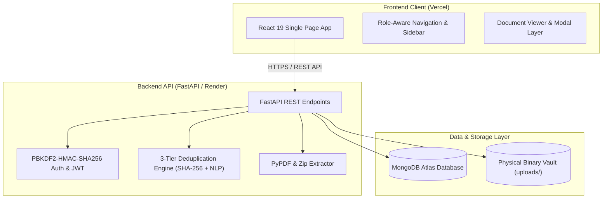

<div align="center">

# 🎓 CampusConnect – Smart Repository Management System

[](https://smart-repo-ten.vercel.app/)
[](https://github.com/Harsh746-bit/SmartRepo)
[](https://fastapi.tiangolo.com/)
[](https://react.dev/)
[](https://www.mongodb.com/atlas)

<p align="center">
  <strong>An enterprise-grade, role-based academic document repository and intelligent asset distribution cloud designed for collegiate institutions.</strong>
</p>

[🚀 Explore Live Application](https://smart-repo-ten.vercel.app/) • [📖 View Documentation](PROJECT_DOCUMENTATION.md) • [🐛 Report Bug](https://github.com/Harsh746-bit/SmartRepo/issues)

</div>

---

## 🌟 Live Demo & Test Credentials

The system is deployed and live at **[https://smart-repo-ten.vercel.app/](https://smart-repo-ten.vercel.app/)**.

You can explore all role-specific workspaces using the pre-configured institutional credentials below, or click **"Create your account"** on the login page:

| Role | Email | Password | Access Capabilities |
| :--- | :--- | :--- | :--- |
| **🛡️ Administrator** | `admin@smartrepo.edu` | `admin123` | Institutional moderation, user lifecycle management, storage analytics, audit logs |
| **👨‍🏫 Faculty / Teacher** | `omkar@gmail.com` | `admin123` | Syllabus publication, course material repository, academic asset downloads |
| **🎓 Student** | `parth@gmail.com` | `parth123` | Lecture note uploads, peer resource browsing, bookmarks, personal recycle bin |

---

## ⚡ Core Innovations & Features

### 1. 🛡️ Strict Server-Side Role-Based Access Control (RBAC)
- **Role Isolation**: Dedicated workspaces for **Students**, **Teachers**, and **Administrators**.
- **Query-Level Security**: Document permissions enforced in MongoDB Atlas queries (not just cosmetic frontend hiding). Students and faculty never access unauthorized private or pending materials.
- **Root Admin Safeguard**: Primary institutional administrator (`admin@smartrepo.edu`) is permanently shielded against accidental deletion, suspension, or role demotion.

### 2. 🔍 Multi-Tier Intelligent Content Deduplication
Traditional systems only check filenames. CampusConnect employs a 3-tier heuristic pipeline:
- **Tier 1 (Streaming SHA-256 Digest)**: Instant binary deduplication without loading unnecessary overhead into RAM.
- **Tier 2 (Normalized Content Hash)**: Textual extraction from PDFs and Office docs to catch re-saved files.
- **Tier 3 (Plagiarism & Fuzzy Similarity Matching)**: Uses `SequenceMatcher` ($\ge 88\%$ similarity threshold) to intercept submissions with identical body content uploaded under different filenames.

### 3. 🔎 Deep Content & Semantic Synonym Search
- **Full-Text Ingestion**: Automatically parses text from `.pdf`, `.docx`, `.pptx`, `.xlsx`, `.csv`, and `.txt`.
- **Domain Synonym Expansion**: Searching `"ML"` automatically matches *"machine learning"*, *"deep learning"*, *"neural networks"*, and *"AI"*. Searching `"DSA"` matches *"data structures"*, *"trees"*, and *"algorithms"*.

### 4. ♻️ Safe Two-Stage Recycle Bin Vault
- **Soft Deletion**: Accidental deletions move documents to the role-isolated **Recycle Bin Vault**.
- **One-Click Restoration**: Restores files back to the active repository while preserving original status and metadata.
- **Permanent Purge**: High-priority confirmation flow that unlinks physical disk binaries and wipes database records cleanly.

### 5. 📄 Responsive In-App Document Viewer
- High-resolution modal (`94vw` / `92vh`) with dynamic zoom controls ($50\%$ to $200\%$), fullscreen mode, keyboard shortcuts (`Esc`), one-click text copying, and direct downloads.

### 6. 📊 Institutional Analytics & Cryptographic Activity Audit Trail
- Live tracking of storage consumption by category, download frequencies, active user distributions, and cryptographic activity logs for institutional compliance.

---

## 🏗️ System Architecture



---

## 💻 Tech Stack

| Domain | Technologies |
| :--- | :--- |
| **Frontend** | React 19, Vite, Lucide Icons, CSS3 Custom Properties, Responsive App Shell |
| **Backend** | FastAPI, Python 3.11+, Uvicorn, PyPDF, PyJWT, Python-Multipart |
| **Database** | MongoDB Atlas (Multi-collection, indexed on `email`, `uploaded_by_email`, `sha256_hash`) |
| **Hosting & DevOps** | Vercel (Frontend), Render / Railway (Backend), Docker, Docker Compose, Nginx |

---

## 🚀 Local Development Setup

### Prerequisites
- **Node.js** 18+ and **npm**
- **Python** 3.10+
- **Git**

### 1. Clone the Repository
```bash
git clone https://github.com/Harsh746-bit/SmartRepo.git
cd SmartRepo
```

### 2. Backend Setup
```bash
cd backend

# Create and activate virtual environment
python -m venv venv

# Windows:
.\venv\Scripts\activate
# Linux/macOS:
source venv/bin/activate

# Install dependencies
pip install -r requirements.txt

# Run FastAPI development server
uvicorn main:app --reload --host 127.0.0.1 --port 8000
```
Backend API will be live at `http://127.0.0.1:8000`.  
Interactive Swagger docs: `http://127.0.0.1:8000/docs`.

### 3. Frontend Setup
```bash
cd ../frontend

# Install dependencies
npm install

# Start Vite dev server
npm run dev
```
Frontend will be live at `http://localhost:5173`.

---

## 🐳 Turnkey Docker Deployment

To spin up the entire system with persistent volume storage in a single command:

```bash
docker compose up -d --build
```

- **Frontend Application**: `http://localhost:3000`
- **Backend REST API**: `http://localhost:8000`
- **Interactive API Docs**: `http://localhost:8000/docs`

---

## 🌐 Environment Variables

### Backend (`backend/`)
| Variable | Description | Default / Example |
| :--- | :--- | :--- |
| `MONGODB_URI` | MongoDB Atlas Connection String | `mongodb+srv://<user>:<password>@cluster0...` |
| `UPLOAD_DIR` | Directory path for physical file storage | `/app/uploads` |
| `PORT` | Web server port | `8000` |

### Frontend (`frontend/`)
| Variable | Description | Default / Example |
| :--- | :--- | :--- |
| `VITE_API_BASE` | Public URL of the FastAPI backend | `https://smartrepo-backend.onrender.com` |

---

## 📁 Repository Structure

```text
SmartRepo/
├── backend/
│   ├── uploads/              # Physical binary vault for uploaded materials
│   ├── extractor.py          # Document text parser (PDF, DOCX, PPTX) & synonym map
│   ├── main.py               # FastAPI application, auth, RBAC & document routers
│   ├── mongo.py              # MongoDB Atlas connection & index manager
│   ├── requirements.txt      # Python dependencies
│   └── Dockerfile            # Container definition for backend service
├── frontend/
│   ├── public/               # Static assets & SVG icons
│   ├── src/
│   │   ├── components/       # Reusable UI (Sidebar, Navbar, Modals, Cards, Tables)
│   │   ├── pages/            # Role dashboards, Repository, Upload, Audit Logs
│   │   ├── config.js         # Centralized API configuration & sanitization
│   │   ├── App.jsx           # Application shell & client-side route controller
│   │   └── App.css           # Collegiate SaaS design tokens & dark styling
│   ├── vercel.json           # Vercel SPA routing rules
│   ├── nginx.conf            # Production Nginx reverse proxy configuration
│   └── Dockerfile            # Multi-stage production container build
├── docker-compose.yml        # Multi-container orchestration
├── render.yaml               # Render Cloud Blueprint specification
├── PROJECT_DOCUMENTATION.md  # Comprehensive architectural specification
└── README.md                 # Project presentation & guide
```

---

## 📄 License

Distributed under the MIT License. See `LICENSE` for more information.

<div align="center">
  <sub>Developed with ❤️ for collegiate academic resource management.</sub>
</div>
