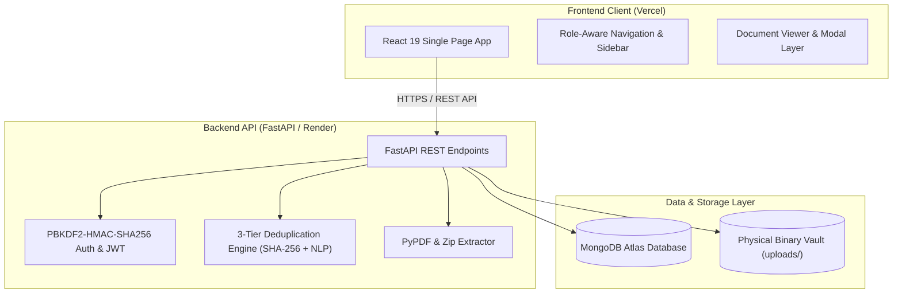

<div align="center">

# 🎓 CampusConnect 2.0 – Secure Academic Repository & Learning Management System

[](https://smart-repo-ten.vercel.app/)
[](https://github.com/Harsh746-bit/SmartRepo)
[](https://fastapi.tiangolo.com/)
[](https://react.dev/)
[](https://www.mongodb.com/atlas)
[](#)

<p align="center">
  <strong>An enterprise-grade, Moodle-inspired academic repository and learning management system with genuine RSA-PSS 3072-bit cryptographic digital signatures, non-repudiation audit trails, binary SHA-256 duplicate defense, strict teacher approval lifecycle, and role-isolated document workflows.</strong>
</p>

[🚀 Explore Live Application](https://smart-repo-ten.vercel.app/) • [📖 View Documentation](PROJECT_DOCUMENTATION.md) • [🐛 Report Bug](https://github.com/Harsh746-bit/SmartRepo/issues)

</div>

---

## 🌟 Live Demo & Test Credentials

The system is deployed and live at **[https://smart-repo-ten.vercel.app/](https://smart-repo-ten.vercel.app/)**.

You can explore all role-specific workspaces using the pre-configured institutional credentials below, or click **"Create your account"** on the login page:

| Role | Email | Password | Access Capabilities |
| :--- | :--- | :--- | :--- |
| **🛡️ Administrator** | `admin@smartrepo.edu` | `admin123` | Institutional moderation, Teacher verification & approval, Verification Center, storage analytics, audit logs |
| **👨‍🏫 Faculty / Teacher** | `omkar@gmail.com` | `admin123` | Course creation & management, Assignment creation & grading, Learning material uploads, digital signature validation |
| **🎓 Student** | `parth@gmail.com` | `parth123` | Course enrollment, In-browser 3072-bit RSA key generation & signing, assignment submission, certificate downloads |

---

## ⚡ CampusConnect 2.0 Core Innovations & Features

### 1. 🔏 Authentic RSA-PSS (3072-Bit) Cryptographic Digital Signatures
- **Client-Side Key Generation**: 3072-bit RSA key pairs generated entirely in-browser via the Web Crypto API (`RSA-PSS`, SHA-256, 32-byte salt).
- **Zero-Knowledge Key Storage**: Private keys are stored strictly in client-side secure storage (`localStorage`) and exportable as encrypted/standard PEM files—**never transmitted to or stored on the backend**.
- **Backend Cryptographic Verification**: Python `cryptography` package verifies signatures using public keys stored in MongoDB Atlas, validating exact binary integrity against the document's SHA-256 digest.
- **Institutional Non-Repudiation Receipts**: Institutional RSA key signs tamper-proof receipts upon verification.
- **Official PDF Verification Certificates**: Generates verifiable PDF certificates with submission hash, signer metadata, and institutional seals via ReportLab.

### 2. 📋 Moodle-Inspired Assignment Management System
- **Teacher Assignment Studio**: Teachers create assignments within their subjects with submission deadlines, instructions, maximum marks, allowed file formats, and configurable late submission & duplicate policies.
- **Student Submission Workflow**: Enrolled students upload submissions, calculate binary SHA-256 in real time, apply client-side RSA-PSS digital signatures, and track evaluation marks and feedback.
- **Teacher Grading & Evaluation**: Teachers review submitted files, verify digital signatures on-demand, enter marks (0–Max Marks), and provide individual qualitative feedback.

### 3. 🛡️ Strict Teacher Registration & Approval Workflow
- **Pending Verification Queue**: Teachers register with Department, Employee ID, and academic credentials. Accounts are flagged as `PENDING` with immediate login and API access blocked.
- **Admin Verification Section**: Institutional administrators inspect credentials and execute one-click **Approval** or **Rejection** with administrative feedback.
- **Strict RBAC Enforcement**: Backend authorization guards ensure only active, approved teachers can create subjects, assign coursework, or upload materials.

### 4. 🔍 Advanced Content-Based Binary SHA-256 Deduplication
- **Binary Fingerprint Hashing**: Calculates SHA-256 directly from raw file bytes, completely ignoring file names, MIME declarations, or path metadata.
- **Renaming Immunity**: Submitting `DSA_Assignment.pdf` and then `My_Assignment.pdf` with identical bytes immediately triggers HTTP 409 Duplicate Detection.
- **Configurable Teacher Policy**: Teachers can toggle duplicate submission permissions per course/assignment.
- **Concurrency & Race Condition Protection**: Async file locks prevent parallel duplicate submission exploits.

### 5. 📚 Faculty Material Sharing vs. Private Student Submissions Isolation
- **Dual Subject Repository Structure**:
  - **A. Faculty Learning Materials**: Accessible to all enrolled students for preview and download; strictly read-only for students.
  - **B. Assignments & Student Submissions**: Isolated per student. Students cannot access classmates' submissions under any circumstances.
- **IDOR Protection**: Database query filters strictly forbid students from accessing submissions or materials from subjects they are not enrolled in.

### 6. 🛡️ Institutional Verification Center & Dashboard
- Dedicated institutional verification pane (`/verification/dashboard`) tracking:
  - System-wide verification metrics (Total, Valid, Tampered, Invalid, Revoked).
  - Searchable verification log across all departments and subjects.
  - Instant one-click cryptographic re-verification and PDF certificate download.

---

## 🏗️ System Architecture



---

## 💻 Tech Stack

| Domain | Technologies |
| :--- | :--- |
| **Frontend** | React 19, Vite, Lucide Icons, CSS3 Custom Properties, Responsive App Shell |
| **Backend** | FastAPI, Python 3.11+, Uvicorn, PyPDF, PyJWT, Python-Multipart |
| **Database** | MongoDB Atlas (Multi-collection, indexed on `email`, `uploaded_by_email`, `sha256_hash`) |
| **Hosting & DevOps** | Vercel (Frontend), Render / Railway (Backend), Docker, Docker Compose, Nginx |

---

## 🚀 Local Development Setup

### Prerequisites
- **Node.js** 18+ and **npm**
- **Python** 3.10+
- **Git**

### 1. Clone the Repository
```bash
git clone https://github.com/Harsh746-bit/SmartRepo.git
cd SmartRepo
```

### 2. Backend Setup
```bash
cd backend

# Create and activate virtual environment
python -m venv venv

# Windows:
.\venv\Scripts\activate
# Linux/macOS:
source venv/bin/activate

# Install dependencies
pip install -r requirements.txt

# Run FastAPI development server
uvicorn main:app --reload --host 127.0.0.1 --port 8000
```
Backend API will be live at `http://127.0.0.1:8000`.  
Interactive Swagger docs: `http://127.0.0.1:8000/docs`.

### 3. Frontend Setup
```bash
cd ../frontend

# Install dependencies
npm install

# Start Vite dev server
npm run dev
```
Frontend will be live at `http://localhost:5173`.

---

## 🐳 Turnkey Docker Deployment

To spin up the entire system with persistent volume storage in a single command:

```bash
docker compose up -d --build
```

- **Frontend Application**: `http://localhost:3000`
- **Backend REST API**: `http://localhost:8000`
- **Interactive API Docs**: `http://localhost:8000/docs`

---

## 🌐 Environment Variables

### Backend (`backend/`)
| Variable | Description | Default / Example |
| :--- | :--- | :--- |
| `MONGODB_URI` | MongoDB Atlas Connection String | `mongodb+srv://<user>:<password>@cluster0...` |
| `UPLOAD_DIR` | Directory path for physical file storage | `/app/uploads` |
| `PORT` | Web server port | `8000` |

### Frontend (`frontend/`)
| Variable | Description | Default / Example |
| :--- | :--- | :--- |
| `VITE_API_BASE` | Public URL of the FastAPI backend | `https://smartrepo-backend.onrender.com` |

---

## 📁 Repository Structure

```text
SmartRepo/
├── backend/
│   ├── uploads/              # Physical binary vault for uploaded materials
│   ├── extractor.py          # Document text parser (PDF, DOCX, PPTX) & synonym map
│   ├── main.py               # FastAPI application, auth, RBAC & document routers
│   ├── mongo.py              # MongoDB Atlas connection & index manager
│   ├── requirements.txt      # Python dependencies
│   └── Dockerfile            # Container definition for backend service
├── frontend/
│   ├── public/               # Static assets & SVG icons
│   ├── src/
│   │   ├── components/       # Reusable UI (Sidebar, Navbar, Modals, Cards, Tables)
│   │   ├── pages/            # Role dashboards, Repository, Upload, Audit Logs
│   │   ├── config.js         # Centralized API configuration & sanitization
│   │   ├── App.jsx           # Application shell & client-side route controller
│   │   └── App.css           # Collegiate SaaS design tokens & dark styling
│   ├── vercel.json           # Vercel SPA routing rules
│   ├── nginx.conf            # Production Nginx reverse proxy configuration
│   └── Dockerfile            # Multi-stage production container build
├── docker-compose.yml        # Multi-container orchestration
├── render.yaml               # Render Cloud Blueprint specification
├── PROJECT_DOCUMENTATION.md  # Comprehensive architectural specification
└── README.md                 # Project presentation & guide
```

---

## 📄 License

Distributed under the MIT License. See `LICENSE` for more information.

<div align="center">
  <sub>Developed with ❤️ for collegiate academic resource management.</sub>
</div>
